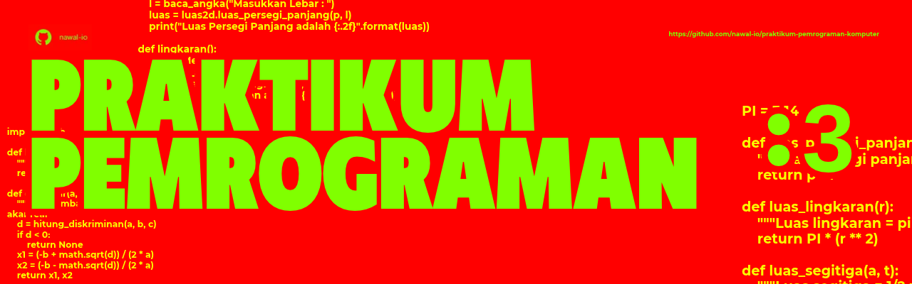

# Praktikum Pemrograman Komputer

Repositori ini digunakan sebagai tempat penyimpanan (*backup*) dan dokumentasi kode program, materi, serta tugas selama mengikuti kegiatan **Praktikum Pemrograman Komputer**.

## 📁 Struktur Direktori

Berikut adalah daftar folder dan file yang tersimpan di dalam repositori ini:

* **`assets/`** — Menyimpan aset gambar dan media pendukung dokumentasi (termasuk `banner.svg`).
* **`module b13/`** — Materi dan latihan mengenai **Pemrograman Modular** menggunakan bahasa Python:
  * `B13. Pemrograman Modular.pdf` — Dokumen modul panduan praktikum.
  * `kuadrat.py` — Modul fungsi perhitungan nilai kuadrat.
  * `luas2d.py` — Modul fungsi perhitungan luas bangun datar dua dimensi.
  * `program1.py` — Implementasi program utama bagian pertama.
  * `program2.py` — Implementasi program utama bagian kedua.

## 🛠️ Teknologi yang Digunakan

* **Bahasa Pemrograman:** Python 3
* **Version Control:** Git & GitHub

## 🚀 Cara Menjalankan Kode

1. Pastikan **Python** sudah terinstal di komputer Anda.
2. *Clone* repositori ini ke penyimpanan lokal:
   ```bash
   git clone https://github.com
   ```
3. Masuk ke folder modul dan jalankan file Python melalui terminal:
   ```bash
   cd "praktikum-pemrograman-komputer/module b13"
   python program1.py
   ```

---
*Catatan: Repositori ini dikelola oleh **nawal-io** sebagai arsip pembelajaran pribadi.*
